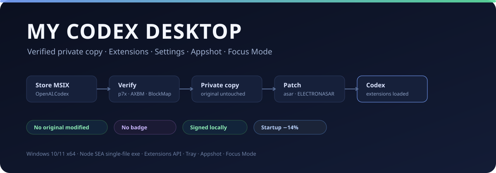
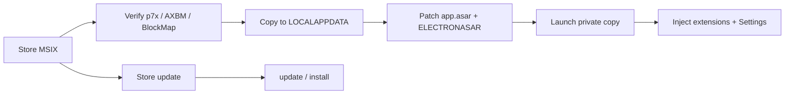

# My Codex Desktop

<p align="center">
  
</p>

<p align="center">
  <strong>给 Windows 版 Codex 加一层可控的本地增强，而不修改商店原包。</strong><br>
  验证 MSIX 签名 → 复制私有副本 → 打补丁 → 加载本地扩展、Settings、托盘、Appshot 和 Focus Mode。
</p>

<p align="center">
  
  
  
  <a href="https://github.com/cx994/my-codex-desktop/releases/latest"></a>
</p>

<p align="center">
  <a href="https://github.com/cx994/my-codex-desktop/releases/latest"><strong>下载 my-codex-desktop.exe ↗</strong></a>
  &nbsp;·&nbsp;
  <a href="#快速开始">快速开始</a>
  &nbsp;·&nbsp;
  <a href="#实测启动性能">启动性能</a>
  &nbsp;·&nbsp;
  <a href="#功能">功能</a>
  &nbsp;·&nbsp;
  <a href="https://github.com/cx994/my-codex-desktop/issues">反馈</a>
</p>

My Codex Desktop 是 Windows 版 Codex（Microsoft Store 的 `OpenAI.Codex`）的本地增强工具。它**不修改原包**：先验证商店包的 MSIX 签名和 BlockMap，再把应用复制到 `%LOCALAPPDATA%\CodexPP\app`，只补丁这份私有副本。

默认不注入任何右下角徽标。内置扩展只有 **Settings** 和 **Hide Codex Logo**。

> 非 OpenAI 官方项目。修改后的副本没有 MSIX package identity，也不是 OpenAI 的签名；使用前请阅读[安全边界](#安全边界)。

## 快速开始

### 直接使用 exe

1. 从 [Releases](https://github.com/cx994/my-codex-desktop/releases/latest) 下载 `my-codex-desktop.exe`。
2. 完全退出 Codex（`ChatGPT.exe` 不能运行）。
3. 安装并签名：

```powershell
.\my-codex-desktop.exe install --sign
```

4. 启动：

```powershell
.\my-codex-desktop.exe launch
```

安装会创建 **My Codex Desktop** 和 **My Codex Desktop Tray** 开始菜单快捷方式。以后从快捷方式启动的是补丁副本；原来的商店快捷方式仍然启动未修改的原版。

### 从源码运行

```powershell
git clone https://github.com/cx994/my-codex-desktop.git
cd my-codex-desktop
npm install
node src/cli.js install --sign
node src/cli.js launch
```

要求：Windows 10/11 x64、已安装 Store 版 Codex、Node 20+（仅源码模式；exe 自带 Node 24 SEA 运行时）、约 5 GB 可用空间。

## 实测启动性能

在 `26.1021.3705.0` x64 上，用 `node bench-startup.js` 冷启动 3 次取中位数；每次启动前结束所有 `ChatGPT.exe`：

| 版本 | 到 `did-finish-load` | 到 DOM `ready: complete` |
|---|---:|---:|
| 未启用 startup 补丁 | 1837 ms | 4444 ms |
| 默认 `shared,initial` | **1579 ms** | **4174 ms** |
| 变化 | **−14%** | **−6%** |

默认只启用 `shared` + `initial` 两个 renderer chunk（13 个编辑，覆盖 settings cache-first、Statsig cache-first、首帧 unthrottle、dictation 延迟、光标/ shimmer、resize 同步等），并包含 CSS 容器查询重写。

完整 startup 集合（含 main/html）在当前 Windows 构建上会让首窗口明显变慢，因此**不作为默认**。需要实验时：

```powershell
.\my-codex-desktop.exe repatch --startup-chunks shared,initial,html
.\my-codex-desktop.exe repatch --no-startup      # 关闭 startup 补丁
```

发现结果写到 `app/resources/codexpp-startup-discovery.json`。

## 功能

| 模块 | 能力 |
|---|---|
| **信任链** | `AppxSignature.p7x` Authenticode 验签 → 签名内 `AXBM` = `AppxBlockMap.xml` 的 SHA-256 → 用 BlockMap 的 64 KB 块逐文件校验（3,670 文件 / 2.2 GB） |
| **私有副本** | 复制到 `%LOCALAPPDATA%\CodexPP\app`；receipt、快捷方式、`restore`；原包不动 |
| **ASAR 补丁** | 注入 `codexpp-bootstrap.js`，改 `package.json` 的 `main`；重建 ASAR；把 header SHA-256 写回 `ChatGPT.exe` 的 `INTEGRITY/ELECTRONASAR` |
| **扩展宿主** | `%APPDATA%\CodexPP\extensions\*`，注入所有 `app://` 窗口（含已存在和新建 `webContents`） |
| **Settings** | 原生 AST 页面（按构建校验）+ 浮动 shadow-DOM 面板；`Ctrl+Alt+Shift+,` 或托盘打开 |
| **Hide Codex Logo** | 隐藏左上角 Codex 字标，保留模式切换小箭头 |
| **托盘** | Status、Launch、Appshot、Settings、Focus Mode、扩展目录、日志、Check Codex update、Update Codex++、Restore、Exit |
| **Focus Mode** | 全屏 + 隐藏菜单栏，通过 `command.json` 发给运行中的 bootstrap |
| **Appshot** | Electron `capturePage` 捕获 Codex 窗口为 PNG，并写同名 JSON（标题/尺寸/可见文本） |
| **浏览器桥** | `api.browser` 对页面 `<webview>` 执行 `list` / `eval` / `load` / `fill` |
| **本地签名** | 自签名证书 `CN=CodexPP Local Signing`，导入 CurrentUser Root/TrustedPublisher，`status` 显示 `Signature: Valid`；repatch 自动重签 |
| **更新** | `check-update` / `update` 同步商店版本；源码模式 `self-update` 校验 manifest + SHA-256；exe 从 Releases 更新 |

### 不包含

- 右下角 Codex++ 徽标（已移除 demo 扩展）。
- macOS 专有的 WebKit AutoFill 原生插件；Windows 用 `<webview>` 桥。
- CUA `get_app_state` 的可访问性文本接入；Appshot 走 Electron 捕获。
- 打包 exe 的自更新（exe 从 Releases 下载新版）。

## 工作原理



1. `Get-AppxPackage` 定位 `OpenAI.Codex`。
2. 验证 `AppxSignature.p7x` 的 Authenticode 签名，pin publisher `CN=50BDFD77-…` 和 Microsoft Marketplace CA。
3. 读取签名内 `AXBM` 摘要，与 `AppxBlockMap.xml` 的 SHA-256 比对。
4. 用 BlockMap 的 64 KB 未压缩块逐文件校验。
5. 复制整个包到 `%LOCALAPPDATA%\CodexPP\app`。
6. 在 ASAR 根新增 `codexpp-bootstrap.js`，改 `package.json` 的 `main`；保留原 main、unpacked 条目和每文件 integrity。
7. 把新 ASAR header SHA-256 写回 `ChatGPT.exe` 的 `INTEGRITY/ELECTRONASAR`（等长覆盖）。
8. bootstrap 先枚举/监听 `webContents`，注入扩展；再加载原 main。
9. 安装/repatch 时写 receipt；`status` 校验 ASAR/资源哈希、签名和商店版本漂移。

## 命令

exe 和源码模式参数一致：

```powershell
my-codex-desktop.exe verify [--fast]
my-codex-desktop.exe install [--sign] [--no-startup] [--launch]
my-codex-desktop.exe repatch [--sign] [--no-startup] [--startup-chunks shared,initial]
my-codex-desktop.exe sign
my-codex-desktop.exe appshot [--out path] [--open]
my-codex-desktop.exe check-update
my-codex-desktop.exe update [--launch]
my-codex-desktop.exe self-update [--manifest path|url] [--check]   # 源码模式
my-codex-desktop.exe tray
my-codex-desktop.exe launch
my-codex-desktop.exe status
my-codex-desktop.exe restore
my-codex-desktop.exe ext list|add|enable|disable
my-codex-desktop.exe doctor
```

`install`、`sign`、`repatch` 需要先退出 Codex。`launch` 在 `ChatGPT.exe` 已运行时拒绝启动：副本与原版共用 `%APPDATA%\Codex`，单实例锁会把第二个实例转发给第一个。

## 扩展 API

扩展目录：`%APPDATA%\CodexPP\extensions\<id>`。

```json
{
  "id": "you.extension",
  "name": "Your Extension",
  "version": "0.1.0",
  "scope": "renderer",
  "main": "index.js"
}
```

`index.js` 以函数体执行，参数是 `api`：

```js
api.addStyle('.foo { color: red; }');
api.on(window, 'keydown', (event) => { /* ... */ });
api.onCleanup(() => { /* ... */ });
api.log('loaded');
```

可用 API：`api.addStyle`、`api.on`、`api.onCleanup`、`api.log`、`api.id`、`api.manifest`、`api.version`、`api.extensions`、`api.browser`。

```js
api.browser.list();                       // [{ index, src }]
await api.browser.eval(0, 'document.title');
await api.browser.load(0, 'https://example.com');
await api.browser.fill(0, '#email', 'you@example.com');
```

扩展是可信代码，不是沙箱；`api.browser` 只作用于页面里的 `<webview>`，主进程 `BrowserView` 不在范围内。

## Settings

**浮动面板**：内置扩展 `com.codexpp.settings`，在每个 `app://` 窗口注入 shadow DOM 面板。`Ctrl+Alt+Shift+,` 或托盘 **My Codex Desktop Settings** 打开；可查看/开关扩展、打开扩展目录/日志、重载窗口。

**原生页面**：AST 适配器在安装/repatch 时对 `webview/assets` 的 Settings 模块做结构化发现，补丁后注册 **Settings → Extensions**。该适配器按构建校验；当前 `26.1021.3705.0` 上因 title metadata 结构变化而回退到浮动面板，安装不会因此失败。

开关写入 `%APPDATA%\CodexPP\config.json`，重载窗口生效。

## 文件位置

| 内容 | 路径 |
|---|---|
| 私有应用副本 | `%LOCALAPPDATA%\CodexPP\app` |
| exe 运行时 | `%LOCALAPPDATA%\CodexPP\tool\<version>-<hash>` |
| 安装记录 | `%LOCALAPPDATA%\CodexPP\receipt.json` |
| 开始菜单 | `%APPDATA%\Microsoft\Windows\Start Menu\Programs\My Codex Desktop*.lnk` |
| 扩展 | `%APPDATA%\CodexPP\extensions\<id>` |
| 配置 | `%APPDATA%\CodexPP\config.json` |
| 托盘命令 | `%APPDATA%\CodexPP\command.json` |
| 签名标记 | `%APPDATA%\CodexPP\signing.json` |
| Appshot | `%APPDATA%\CodexPP\appshots\<timestamp>.png` |
| 运行日志 | `%APPDATA%\CodexPP\codexpp.log` |
| 托盘日志 | `%APPDATA%\CodexPP\tray.log` |

## 安全边界

- 只修改私有副本；`restore` 删除副本、快捷方式和托盘，不触碰商店原包。
- 修改后的 `ChatGPT.exe` 只有本地自签名证书，不是 OpenAI 签名；Smart App Control 开启或企业 WDAC/AppLocker 可能拦截。
- 副本没有 MSIX package identity：通知、开机任务、COM、execution alias、商店自动更新仍属于原包。
- 商店更新后需要 `update` / `install`；`status` 会报告版本漂移。
- 原生 Settings AST 按构建校验；失配时回退浮动面板。
- Appshot 走 Electron `capturePage`；浏览器桥只覆盖 `<webview>`。
- 扩展是可信本地代码；只安装你审查过的扩展。

## 构建 exe

exe 使用 **Node SEA**（单文件，自带 Node 24），构建时把运行所需的 `src/`、`adapters/`、`runtime/`、`extensions/`、`tray.ps1` 打包进 exe；首次运行解压到 `%LOCALAPPDATA%\CodexPP\tool\<version>-<hash>`。

```powershell
npm install
npm run build:exe
# -> dist/my-codex-desktop.exe
```

验证：

```powershell
node test/extension-id.test.js
node bench-startup.js
.\dist\my-codex-desktop.exe doctor
```

## 第三方与许可

- `adapters/acorn.js`、`settings-adapter.js`、`startup-adapter.js`、`parser-runner.js` 来自 [b-nnett/codex-plusplus](https://github.com/b-nnett/codex-plusplus)（MIT）；`native-settings.js` 是针对 Windows 命令通道重写的运行时。
- Acorn 为 MIT。
- Node.js 运行时为 MIT；exe 内包含 Node 的第三方许可。
- 本项目为 MIT；详见 [`LICENSE`](./LICENSE) 和 [`THIRD_PARTY_NOTICES.md`](./THIRD_PARTY_NOTICES.md)。

非 OpenAI 官方项目，与 OpenAI 无隶属或背书关系。
